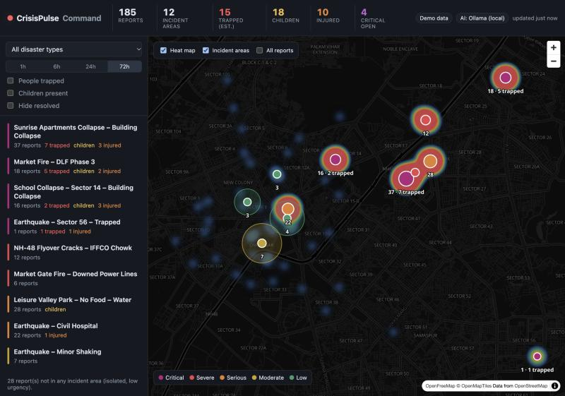
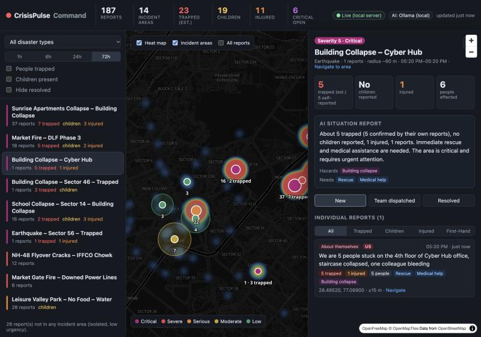
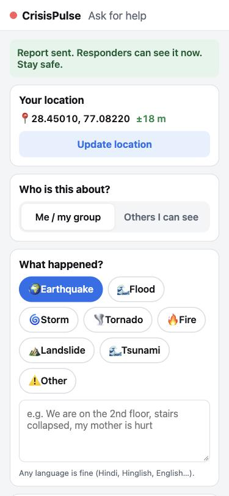

# CrisisPulse

### 🖥️ Command dashboard (for responders): **https://crisispulse-umber.vercel.app**
### 🆘 Ask for help (for people in the disaster area): **https://crisispulse-umber.vercel.app/report**

**Team veretas:** Vishesh Dahiya, Sehaj Preet Singh · **Buildathon track:** Build for the Physical World (`physical-world`)

CrisisPulse turns the flood of messages people send during an earthquake, storm, tornado or flood into a live rescue map. Anyone in the affected area can send a geotagged update about themselves or what they can see: what happened, who is trapped, whether children are there, who is injured and what they need, with photos. They can use the web help form (no install) or the Android/iOS app, and both keep working on a bad connection. A local AI on the coordinator's Mac reads every report in any language (English, Hindi, Hinglish), groups reports about the same incident in the same area, and writes a short situation report for each one: what is happening, how many people are trapped, whether children are present, injuries, hazards and needs. Responders see it all on the dashboard as a heat map plus incident areas ranked by severity, and can open any area to read every individual report behind the summary.

### The problem
In the first hours after a disaster, the people who know where others are trapped are the survivors and bystanders on the ground. Control rooms instead get a flood of phone calls, WhatsApp forwards and social posts: unstructured, duplicated and with no reliable location. Twenty people reporting the same collapsed building look like twenty incidents, while one elderly person pinned under a wall in a quiet street gets lost in the noise. Coordinators can't answer the questions that decide where a rescue team goes first: *where are people trapped, how many, and are children among them?*

### What we built
1. **Help form (web, any phone, no install)** at [`/report`](https://crisispulse-umber.vercel.app/report): location from the browser, "about me / my group" or "others I can see", what happened, free text in any language, people / trapped / injured counts, children present, needs (rescue, medical, water, food, shelter…) and up to 3 compressed photos. If there is no signal, the report is queued in the browser and sent automatically later.
2. **Mobile app (Android + iOS, Expo)** with the same form, saved on the phone first and sent when signal returns. Retries can never create duplicates (every report carries a `client_id`). Android APK download is in the Demo section below.
3. **AI worker (runs locally with Ollama, no cloud AI).** For every report it extracts structured facts with an LLM (`qwen2.5:7b-instruct`, JSON-schema output) checked by code guardrails, embeds the text (`nomic-embed-text`), groups reports into incident areas, computes the numbers in code, and writes a situation report per area.
4. **Command dashboard** at [crisispulse-umber.vercel.app](https://crisispulse-umber.vercel.app): heat map, incident areas coloured by severity with trapped counts, the AI situation report per area (trapped estimate vs self-reported, children, injured, hazards, needs), a status workflow (new → team dispatched → resolved), one-tap directions, and every individual report in an area with filters and its exact pin on the map.

```
help form / phone app ──▶ AI server on the coordinator's Mac (Ollama) ──▶ command dashboard
        (any network, via a secure tunnel)        extract → cluster → count → summarise      (Vercel)

Production path, also in this repo: phones ──▶ Supabase (Postgres + PostGIS, private photos, realtime) ◀── AI worker
```

### The hardest part: turning noisy crowd reports into numbers a rescuer can trust
- **Clustering by place *and* meaning.** DBSCAN where two reports are neighbours only if they are within 500 m **and** about the same thing, or practically on the same spot (≤ 50 m). "Same thing" blends the facts the LLM extracted (hazards, needs, trapped) with mean-centred `nomic-embed-text` embeddings: we measured raw embeddings scoring ~0.79 between *different* incidents, too uniform to use alone. A building collapse and a transformer fire 250 m apart on the same street stay separate incidents; thirty descriptions of one collapse merge into one.
- **Never hide a lone emergency.** A single report with someone trapped or urgency ≥ 4 becomes its own incident area even if nobody else reported it (the 71-year-old pinned under a wall in Sector 56 in our demo).
- **No double counting.** Numbers are computed in code, never by the LLM:
  - *First-hand* reports ("we are 3, stuck in the basement") are different people, so they are **summed**, after merging duplicates (same spot + near-identical text = the same family sending twice; take the max).
  - *Witness* reports ("about 6 people trapped") describe the same victims many times, so they are **never summed**; we take the highest number at least two witnesses agree on (or the upper quartile if none agree).
  - The area's estimate is `max(first-hand total, witness estimate)`, and the dashboard shows both "trapped (est.)" and "self-reported".
- **The LLM never does the arithmetic.** In testing, the 7B model wrote "at least 28 people trapped" by adding witness reports together, invented a "Downtown Area", and tagged a market fire with "flooding". So: the people-count sentence of every situation report is written in code from the verified totals, any LLM sentence that states a count is removed, place names that no report mentions are dropped from titles, an LLM hazard is kept only if the text backs it up, and explicit numbers found by a keyword reader act as a floor under the LLM's counts. A single uncorroborated big claim is shown separately ("one report says up to 8") instead of driving the estimate.
- **The reporter beats the model.** Checkbox answers from the phone always override what the LLM inferred; the LLM fills in the gaps from free text. Negations ("no injuries") are handled in the offline fallback.
- **Stable incidents.** Clusters keep their id between runs (matched by member overlap), so a coordinator's "team dispatched" status survives re-clustering, and only areas whose members changed are re-summarised.
- **Works without the cloud AI and without signal.** If Ollama is down, a keyword extractor and topic vectors keep the pipeline running; phones queue reports offline.

### Demo
| | Link |
|---|---|
| Command dashboard (live while the Mac's AI server and tunnel run; falls back to demo data) | https://crisispulse-umber.vercel.app |
| Help form for anyone, no install | https://crisispulse-umber.vercel.app/report |
| Android app (APK, 101 MB, built with EAS) | https://expo.dev/artifacts/eas/xh998uB-7I9trAPRPHu4IQjNbKyZkAM0W1qkXSIHPLg.apk |

| Help form QR | Android APK QR |
|---|---|
|  |  |

**Incident map:** heat map, incident areas by severity, the lone trapped person in Sector 56 kept visible.


**One incident:** a live report sent from a phone, AI situation report with verified numbers, individual reports.


**Help form (phone browser):**


### How to run it

**Quick demo (no accounts needed)**
```bash
npm install
npm run demo        # AI pipeline on a synthetic M6.4 Gurugram earthquake (≈185 reports)
npm run dashboard   # open http://localhost:5173
npm test            # clustering + counting tests
```
With [Ollama](https://ollama.com) running (`ollama pull qwen2.5:7b-instruct && ollama pull nomic-embed-text`) the demo uses real LLM extraction, embeddings and summaries; without it, the keyword fallback is used.

**Live demo on one Mac (no cloud account): phones on the same Wi-Fi report straight to the Mac**
```bash
npm run local -w worker -- --reset --empty   # terminal 1: local server + AI (prints the Mac's Wi-Fi address)
npm run dashboard                            # terminal 2: shows "Live (local server)"
npm run simulate                             # optional: replays the earthquake as a live feed
```
For phones: put `EXPO_PUBLIC_LOCAL_API=http://<mac-ip>:8787` in `apps/mobile/.env`, run `npm run mobile` and open it in Expo Go. Reports (with photos) appear on the dashboard within seconds; offline retries are de-duplicated by `client_id`.

**Live on the hosted dashboard (phones on any network)**
```bash
npm run local -w worker                                  # local server + Ollama on the Mac
cloudflared tunnel --url http://localhost:8787           # prints https://<name>.trycloudflare.com
VITE_LOCAL_API=https://<name>.trycloudflare.com npm run build -w dashboard   # then deploy dist/ to Vercel
```
Put the same URL in `apps/mobile/.env` as `EXPO_PUBLIC_LOCAL_API`. If the Mac or tunnel is off, the hosted dashboard falls back to the demo data.

**Full live setup (Supabase, works across networks)**
1. Create a Supabase project, run `supabase/migrations/0001_init.sql` in the SQL editor, enable **Anonymous sign-ins** (phones) and **Email** (coordinators).
2. Create a coordinator user, then: `insert into dashboard_admins (user_id) select id from auth.users where email = 'you@example.com';`
3. Copy each `.env.example` to `.env`: `apps/worker` (URL + service-role key, Mac only), `apps/dashboard` (URL + anon key), `apps/mobile` (URL + anon key).
4. `npm run worker` (leave running), `npm run dashboard`, `npm run mobile` and scan the QR code with Expo Go on Android or iOS. Optional: `npm run seed` loads the synthetic earthquake.

**Repo layout:** `apps/mobile` (Expo app), `apps/worker` (AI pipeline: `extract.ts`, `cluster.ts`, `aggregate.ts`, `summarise.ts`), `apps/dashboard` (Vite + React + MapLibre), `packages/shared` (types + schemas), `supabase/migrations` (schema + row-level security).

**Privacy:** reports are never public. Phones can insert reports and read only their own; only coordinators in `dashboard_admins` can read reports, clusters and photos (row-level security). Photos are in a private bucket and shown through short-lived signed URLs. The AI runs on the coordinator's own machine.

---

## About the Buildathon (starter repo notes)

### 🚀 Buildathon: Make Wednesdays Great Again

**Masters' Union · For AI Developers · Winner gets Rs. 25,000**

> **Every team must build in a fork of this repository.** Projects not built in a fork of this repo won't be judged.

| | |
|---|---|
| **Date** | Wednesday, 18 November 2026 |
| **Hacking** | **3:00 PM – 7:00 PM IST** (code freeze at 7:00 PM sharp) |
| **Venue** | CDS Audi, 8th floor |
| **Prize** | Rs. 25,000 to the winning team |
| **Register your fork** | 👉 **[https://forms.gle/ZJUYKwTYjsMsVB2b9](https://forms.gle/ZJUYKwTYjsMsVB2b9)** (**deadline 3:30 PM IST**) |
| **Final submission** | Your fork as it stands at **7:00 PM IST**. There's nothing else to submit. |

> 🤖 **Using an AI coding agent?** Point it at [`AGENTS.md`](AGENTS.md). It has the full event brief, tracks, judging and rules in a form agents can read directly. Claude Code loads it automatically through `CLAUDE.md`, and Codex reads `AGENTS.md` natively.

---

### 🎯 Pick one build track

| # | Track | Brief |
|---|---|---|
| **01** | **Build for the Physical World** | Make a real-world task easier, faster or more reliable. Show it in a realistic scenario. |
| **02** | **Build for AI Agents** | Find something an agent struggles with. Build the tool that fixes it, then demo the agent using it. |
| **03** | **Build in Your Area of Expertise** | Pick a field you know firsthand. Ship a working product that improves how people handle it today. |

### ⚖️ How you'll be judged (each criterion is ⅓ of your score)

| Criterion | The question judges ask |
|---|---|
| **Working product** | Does it do what you say it does? Show the core workflow in your demo. |
| **Problem insight** | Who faces this problem, and why does it happen? |
| **Depth of execution** | How well did you solve the hardest part of the build? |

---

### Why fork this repo?

Everyone starts from the same commit (the **genesis commit**) at the same time. Organizers can then check that:
- all code was written **during** the Buildathon and not brought in from an earlier project,
- teams commit steadily instead of pasting in one huge AI-generated dump at the end,
- every repo stays public and visible while you build.

The organizers track every fork automatically: commits, timing and activity. Read [RULES.md](RULES.md) before you write any code.

---

### ✅ Setup (about 5 minutes, do it at 3:00 PM)

**In short:** fork → register your fork in the form **by 3:30 PM** → build → push before 7:00 PM.

#### 1. Fork this repo
Click **Fork** (top right). On the fork screen:
- **Owner:** one team member's personal account. Only **one fork per team**.
- **Repository name:** `buildathon-<team-name>`, for example `buildathon-byte-bandits`
- Click **Create fork**.

> ⚠️ Don't download a ZIP or copy the files into a new repo. **It has to be a real GitHub fork**, or the tracker can't see you.

#### 2. Keep it public
Forks of a public repo are public. **Don't make it private, archive it, or delete it** until judging is over.

#### 3. Add your teammates
In your fork: **Settings → Collaborators → Add people**. Add each teammate's GitHub account so their commits count toward the team.

#### 4. Enable Actions
Open the **Actions** tab of your fork and click **"I understand my workflows, go ahead and enable them"**. This runs the automatic check on every push.

#### 5. Make your registration commit (your first commit)
Fill in [`team.json`](team.json). `track` must be one of `physical-world`, `ai-agents` or `area-of-expertise`. Then:

```bash
git clone https://github.com/<your-username>/buildathon-<team-name>.git
cd buildathon-<team-name>
# edit team.json
git add team.json
git commit -m "register: <team name>"
git push
```

The **Hackathon check** in the Actions tab should go green ✅. If it's red, open the run to see what's wrong in `team.json`.

#### 6. Register your fork (deadline: 3:30 PM IST)
👉 **[https://forms.gle/ZJUYKwTYjsMsVB2b9](https://forms.gle/ZJUYKwTYjsMsVB2b9)**

It's a 4-question Google Form: team name, fork link, track, team members. It connects your repo to the organizers' live tracker.

- Fill it in **once per team**, right after forking, and **no later than 3:30 PM IST**. **Teams that don't register can't be tracked.**
- Paste your **fork's** URL (`https://github.com/<you>/buildathon-<team-name>`), not this starter repo's.
- Need to change something? Use the **"Edit your response"** link on the confirmation page. Don't fill it in twice.
- **Final submission is automatic.** Whatever is pushed to your fork at 7:00 PM IST is what gets judged.

---

### 🛠 While you build (3:00 – 7:00 PM)

- Put your code anywhere in the repo (`app/`, `src/`, `frontend/`, `backend/`…). There's no required layout.
- **Commit early, commit often**, at least every 30 minutes of real work, with messages that say what changed.
- **Push regularly.** Commits you never push don't exist to the tracker.
- AI coding tools (Claude Code, Codex, Cursor, Copilot…) are **allowed and encouraged**. Keep `AGENTS.md` and `CLAUDE.md` in the repo; they keep your agent within the rules.
- Before 7:00 PM, replace the "Your project" section below with your project's README.

### 🧊 Code freeze: 7:00 PM IST

At 7:00 PM the tracker takes a snapshot of every fork. **Commits pushed after code freeze are ignored.** Judges look at your last commit before 7:00 PM.

### ❌ Things that get you flagged

- Rewriting history (`git push --force`, rebasing away the genesis commit, squashing everything into one commit)
- Commits dated before 3:00 PM
- One or two giant commits containing most of the project
- A repo that isn't a fork of this one, or that's private or deleted

See [RULES.md](RULES.md) for the full list.

---
